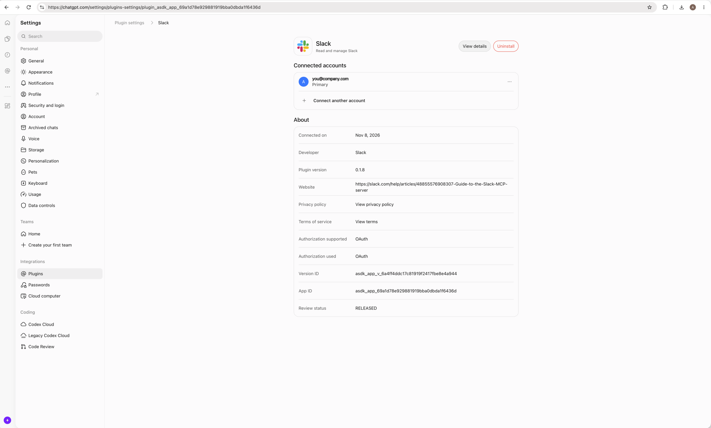

# omp-slack

An OMP plugin that reaches Slack through the **ChatGPT Slack app**. It signs in to ChatGPT with its own OAuth login and talks to the ChatGPT apps MCP gateway (`https://chatgpt.com/backend-api/ps/mcp`). Every Slack operation, read or write, goes through one discoverable `xd://slack` device, and read-only `slack://` URLs expose the same reads to OMP's `read`, `glob`, and `grep` tools. You don't create a Slack app or OAuth client.

## Install

```sh
omp plugin install github:anatoli-tsinovoy/omp-slack
```

OMP accepts `github:user/repo` plugin sources. Restart OMP if the current session does not discover the plugin. Requires OMP 18.18.1 or newer.

## Setup

### 1. Install Slack in ChatGPT

1. Sign in at [chatgpt.com](https://chatgpt.com) with the account and ChatGPT workspace that should reach Slack (for a work Slack, use your work ChatGPT workspace).
2. Open **Settings → Plugins**, choose **Slack**, and connect it to your Slack workspace. Your ChatGPT workspace admin may need to enable the Slack app first.



### 2. Sign in from OMP

Run `/slack login` in OMP. Like OMP's own `/login openai-codex`, it opens a sign-in dialog that shows the full ChatGPT authorization URL, a local shortcut (`http://localhost:1455/launch`, this machine only), and a paste field, and it tries to open your browser. Pick the same account and ChatGPT workspace as in step 1. After sign-in, the Slack tools load into the current session.

On a headless or remote host (SSH, containers), open the full authorization URL in a browser on any machine. Once you sign in, the browser lands on `http://localhost:1455/auth/callback?code=…`, which won't load. Copy that whole URL from the address bar and paste it into the dialog. The authorization code alone also works. When OMP runs on the same machine as the browser, the callback on port 1455 finishes sign-in without a paste.

- `/slack status` shows the signed-in ChatGPT account and the Slack workspaces the app can reach.
- `/slack logout` deletes the plugin's login.

## Credentials

- The login is stored only in `~/.omp/agent/omp-slack/chatgpt-auth.json`, or `chatgpt-auth.<profile>.json` under a non-default OMP profile. The directory is mode `0700` and the file `0600`.
- It is separate from OMP's own logins. `/login openai-codex` and OMP's auth database are neither read nor changed, so the plugin can use a different ChatGPT workspace than your model provider.
- The access token is refreshed with the stored refresh token before it expires, and again after a `401` from the gateway. Neither case needs a new browser sign-in. Concurrent OMP processes pick up each other's rotated tokens from the file.
- A refresh that returns a different ChatGPT workspace is rejected; run `/slack login` again to switch.

## Use

Every Slack operation goes through the `xd://slack` device (`write` JSON to it; `read xd://slack` shows its usage).

Reads have their own ops. `workspace` (team ID or name) is optional when one workspace is connected, and `channel` takes an ID, a name, or `#name`:

```json
{"op":"workspaces"}
{"op":"channels","channel":"eng"}
{"op":"history","channel":"#engineering","limit":20}
{"op":"thread","channel":"C123456","ts":"1712345678.123456"}
{"op":"search","query":"launch plan from:<@U123> after:2026-01-01","scope":"all"}
{"op":"search","query":"budget type:pdfs","type":"files"}
{"op":"profile"}
{"op":"canvas","id":"F0123456"}
{"op":"file","id":"F0123456"}
```

- Channel names resolve through your channel list (`name_prefix`), then through channel search for public channels you haven't joined. Resolved IDs are remembered for the session.
- `history` and `search` results add the exact `thread` op to every message with replies.
- In `search`, modifiers (`in:`, `from:`, `to:`, `after:`, `before:`, `on:`, `during:`, `is:`, `has:`, `type:`) go to Slack's `filters`; the remaining words are keywords (quoted phrases kept whole) and the semantic query. `scope:"all"` adds private channels and DMs.
- The Slack app's JSON-wrapped text replies are shown as their text.

Any other Slack app tool is called directly:

```json
{"op":"tools"}
{"op":"schema","tool":"slack_send_message"}
{"tool":"slack_send_message","args":{"channel_id":"C123456","message":"Hi"}}
{"op":"login"}
```

- `op` defaults to `call`. Tool names drop the gateway's `slack.` prefix (the prefixed form also works).
- With several Slack workspaces, pass the `team_id` from `workspaces` in `args` where the tool's schema accepts it.
- No gateway connection opens until Slack is first used, and no Slack tool schemas enter the model's context at load: `tools` lists names, and each schema arrives only through its own `schema` op.
- Approval tiers: the read ops, `tools`, `schema`, `workspaces`, and calls to the Slack app's read tools (`slack_read_*`, `slack_search_*`, `slack_list_*`, `slack_get_reactions`) run at the `read` tier. Sending, scheduling, reactions, canvas edits, membership changes, uploads, and `login` run at `write`. Tools from other ChatGPT connectors are never listed or callable.

Confirm with the user before sending or scheduling messages, adding reactions, or creating/editing canvases unless they explicitly requested that exact action.

## `slack://` files

OMP's `read`, `glob`, and `grep` tools also see Slack as a read-only tree. The workspace is a team name or ID:

| URL | Reads as |
| --- | --- |
| `slack://` | connected workspaces |
| `slack://Acme/channels/` | channels you're in; each entry is a file holding that channel's recent history |
| `slack://Acme/channels/<name or id>?limit=&oldest=&latest=` | channel history; `:N-M` selects lines |
| `slack://Acme/threads/<channel>/<ts>` | one thread |
| `slack://Acme/users/<id or me>`, `canvases/<id>`, `files/<id>` | a profile, canvas, or file |
| `slack://Acme/search?q=…&scope=all&type=files&limit=` | search results, with the same query handling as the `search` op |

```text
read  slack://Acme/channels/engineering?limit=50
glob  slack://Acme/channels/eng-*
grep  "release" slack://Acme/channels/eng-*
```

- Content is the Slack app's own text, the same as the read ops return. Messages with replies link their thread as a `slack://…/threads/…` URL.
- Channel names resolve through your channel list, then through channel search for public channels you haven't joined. `channels/` lists only what the Slack app returns for your channel list (up to 200); its heading says when that is partial.
- Listings and texts are kept for 60 seconds. `glob` needs only the channel list; `grep` reads the history of every channel it walks, so name the channels.
- OMP refuses `write` and `edit` on `slack://`; sending and other changes go through `xd://slack`. Loading fails if another plugin already owns `slack://`.

## Included prompts

Bundled skills: `slack-search`, `slack-messaging`. Bundled workflow commands are namespaced with `slack-`: `/slack-summarize-channel`, `/slack-find-discussions`, `/slack-draft-announcement`, `/slack-standup`, and `/slack-channel-digest`.

**Avoid duplicate Slack skills:** Do not also run `npx skills add slackapi/slack-skills-plugin`. Its same-named skills target a different tool surface.

**NOTICE:** The `slack-search` and `slack-messaging` skills and five workflow commands are adapted from Slack's `slackapi/slack-skills-plugin` (MIT; Copyright (c) 2020- Slack Technologies, LLC). See [`skills/UPSTREAM-LICENSE`](./skills/UPSTREAM-LICENSE).
